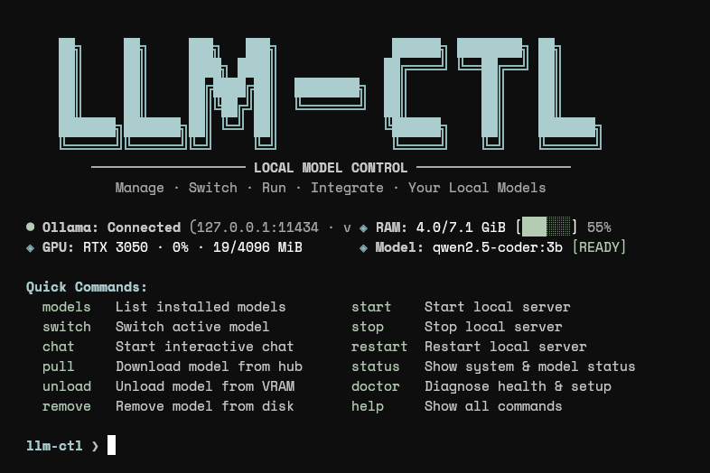

# LLM-CTL

LLM-CTL is a lightweight, native Linux CLI for managing local Ollama models, server lifecycles, and AI coding-agent integrations. Built in pure Rust with zero Python overhead, it runs entirely in user-space, delivers real-time hardware telemetry (RAM, GPU VRAM, compute utilization), and automatically routes local models to developer coding agents like Claude Code, OpenCode, Pi, and DeepSeek Harness.



## Why LLM-CTL?

- **Zero Local Overhead**: Single standalone ~3.6 MB native binary with minimal memory footprint, dynamic-linked only to standard Linux libc.
- **Real Hardware Telemetry**: Live RAM usage via `/proc/meminfo` and GPU/VRAM telemetry via `nvidia-smi`—no fabricated metrics or mock placeholders.
- **Unified Model Management**: Switch, warm, unload, and evict models from VRAM with a single keystroke.
- **Agent Routing**: Automatically configures local coding agents (`Claude Code`, `OpenCode`, `Pi`, `DSH`) to use your active Ollama model.
- **Curated Model Hub**: Intelligent model catalog that calculates VRAM feasibility based on your exact GPU hardware specs before downloading.
- **Safety & Isolation**: Strictly XDG-compliant; never tampers with Ollama's model blobs or requires root/sudo privileges.

## Requirements

- **OS**: Linux (x86_64 or ARM64; Ubuntu 20.04+, Debian, Arch, Fedora).
- **Rust Toolchain**: Rust 1.75+ and Cargo (for compiling from source).
- **Ollama**: Local Ollama server (installed from [ollama.com](https://ollama.com)).
- **GPU (Optional)**: NVIDIA driver and `nvidia-smi` for dedicated GPU & VRAM telemetry (gracefully falls back to CPU mode if absent).

## Installation

### Method 1: One-Line Curl Installer (Recommended)

Install or update LLM-CTL in user space with a single command:

```bash
curl -fsSL https://raw.githubusercontent.com/roninscript30/llm-ctl/main/scripts/install.sh | bash
```

The installer automatically detects your Linux architecture (`x86_64` or `aarch64`), attempts to download the pre-compiled binary release for fast setup, and seamlessly falls back to building from source with Cargo if needed.

### Method 2: From Local Repository

```bash
git clone https://github.com/roninscript30/llm-ctl.git
cd llm-ctl
bash scripts/install.sh
```

Both methods install `llm` and symlink `llm-ctl` into `~/.local/bin` without requiring root or `sudo` privileges. Ensure `~/.local/bin` is in your `PATH`:

```bash
export PATH="$HOME/.local/bin:$PATH"
```

To build manually:
```bash
cargo build --release
```

Shell completion scripts for Bash, Zsh, and Fish are provided in the `completions/` directory.

## Commands Reference

| Command | Aliases | Description |
| --- | --- | --- |
| `llm` | | Interactive terminal UI with command history and Tab completion |
| `llm status` | `info` | Show Ollama daemon health, active model, and hardware telemetry (`--json` supported) |
| `llm models` | `ls`, `list` | List installed models with parameter sizes, quantization, and disk footprint |
| `llm switch <model>` | `use` | Activate a model, warm it into VRAM, and sync configs for coding agents |
| `llm pull [model]` | | Download model from hub with live stream progress (or display curated catalog) |
| `llm chat [model]` | | Launch interactive chat with the active or specified model |
| `llm unload [model]` | `free`, `evict` | Unload model weights from GPU VRAM without removing weights from disk |
| `llm remove <model>` | `rm`, `delete` | Safely remove model weights from disk after confirmation (or `-y`) |
| `llm start` | `run` | Start Ollama background service (via user systemd or process daemon) |
| `llm stop` | | Stop local Ollama server gracefully |
| `llm restart` | | Restart Ollama server daemon |
| `llm agents [name]` | `launch` | Inspect or launch integrated coding agents (`claude`, `opencode`, `pi`, `dsh`) |
| `llm claude [args]` | `cc` | Launch Claude Code configured for local Ollama |
| `llm opencode [args]`| `oc` | Launch OpenCode CLI routed to the active local model |
| `llm pi [args]` | | Launch Pi Coding Agent routed to the active local model |
| `llm dsh [args]` | `deepseek` | Launch DeepSeek Harness Web interface |
| `llm doctor` | | Comprehensive diagnostics of runtime, drivers, paths, and dependencies |
| `llm config` | | View or update configuration (`show`, `path`, `set <key> <val>`) |
| `llm help` | | Display detailed command documentation |

## Configuration and Storage

LLM-CTL strictly follows the XDG Base Directory specification:

- **Configuration**: `${XDG_CONFIG_HOME:-~/.config}/llm-ctl/config.json`
- **Shell History**: `${XDG_STATE_HOME:-~/.local/state}/llm-ctl/history`
- **Application Logs**: `${XDG_STATE_HOME:-~/.local/state}/llm-ctl/logs/`
- **Cache**: `${XDG_CACHE_HOME:-~/.cache}/llm-ctl/`
- **Runtime Endpoint**: Governed by `OLLAMA_HOST` (defaults to `http://127.0.0.1:11434`)

### Uninstallation

To remove only the binaries while preserving all configurations and Ollama models:
```bash
bash scripts/uninstall.sh
```

To purge binaries, configuration, cache, and history:
```bash
bash scripts/uninstall.sh --purge
```
*Note: Model weights stored by Ollama in `~/.ollama` are never modified or removed during uninstallation.*

## Verification & Static Analysis

```bash
cargo fmt --check
cargo clippy --all-targets --all-features -- -D warnings
cargo test
cargo build --release
```

## Future Roadmap

- Native AMD ROCm (`rocm-smi`) and Intel Arc (`xpu-smi`) hardware telemetry.
- Support for remote Ollama clusters and multi-node model distribution.
- Headless systemd service generator for persistent agent bridges.

## License

MIT License. See [LICENSE](LICENSE) for details.
